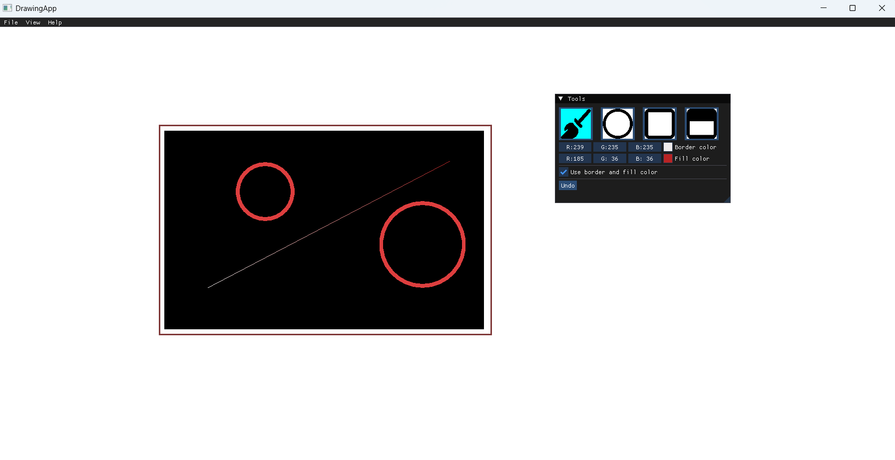

# Drawing App

## Overview
The programme provides the user with **4 ways** to draw on a canvas of a fixed size, as well as **saving and opening** already drawn works.

Supported shapes:
- Lines
- Circles
- Rectangles
- Filled Rectangles

It lets the user change both the fill and outline colors of the figures.



## Features
1. **Additional** options for every shape.
2. **Controls:**
    - 'LCtrl + z' - undo an action
    - 'LCtrl + o' - open file
    - 'LCtrl + s' - save file
3. **Undoing** up to **10** actions
4. A shape is shown in **real-time** while drawing.
5. **Saving and opening** a canvas.

## Setup
Before downloading make sure you have cmake installed. To run the programme, run commands:

```
git clone https://github.com/zagalahubert/Drawing_App.git
cd Drawing_App
cmake -B build -A x64
cmake --build build --config Release
cd build/Release
.\DrawingApp.exe
```

## Technologies
Technologies used:
1. C++
2. SFML
3. ImGui-SFML
4. Dear ImGui
5. ImGuiFileDialog
6. Dirent
7. CMake
8. Roboto font (Apache 2.0)